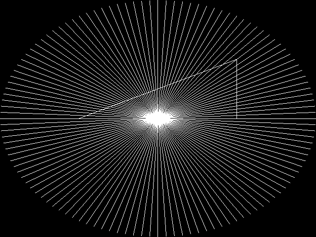
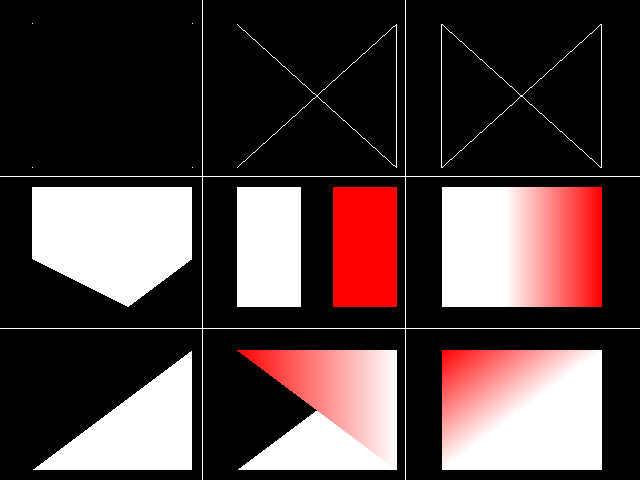
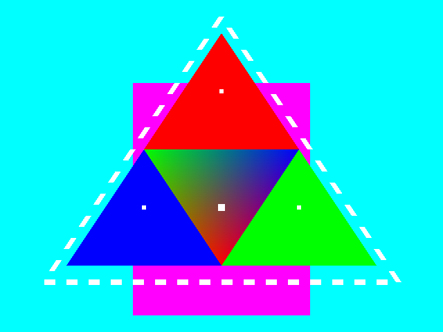
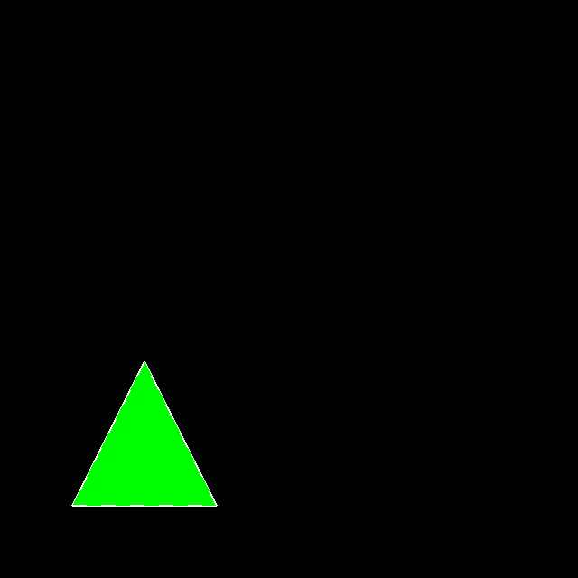
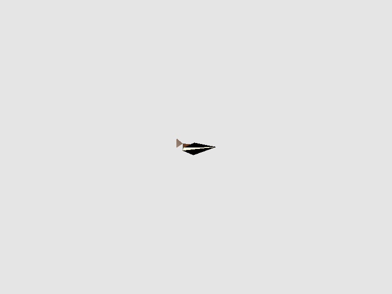
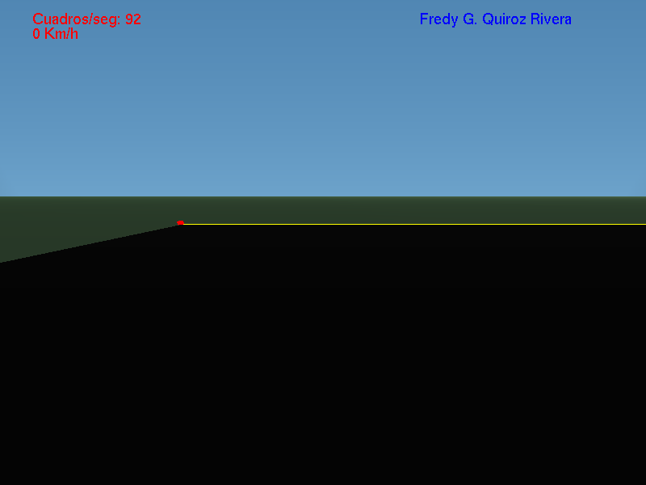

# OpenGL Graphics Exercises
[English](#english) · [Español](#español)

## English


Legacy Windows C++ exercises for drawing, animating and rendering 3D scenes with OpenGL

> [!WARNING]
> **Status: Legacy.** Windows exercises from 2011. Converted to MSVC v145 in 2026. Verified on 2026-11-19.

### Overview

These Windows exercises show how a C++ program turns coordinates into pixels with OpenGL. They form a progression from drawing lines and filled shapes to comparing transformations and animation. The 3DS exercise opens a model made of faces and vertices from a separate 3DS file.

### Screenshots



















### Features

- **`primero`** · Radial lines and a triangle on a black background.
- **`taller4`** · A grid comparing points, line strips and filled polygons.
- **`taller5a`** · Colored primitives viewed under perspective projection.
- **`taller5b`** · Coordinate axes and a radial drawing translated from the center.
- **`taller6`** · A triangle demonstration that animates translation, rotation and scaling.
- **`segundo`** · A 3DS aircraft viewer with several cameras, keyboard input and a speed display.

### Requirements

- On Windows, install [Visual Studio Community](https://visualstudio.microsoft.com/vs/community/) with Desktop development with C++ and a Windows SDK. Use the Win32 target.
- The archived Win32 OpenGL, GLU and GLAUX headers and libraries are included under include/ and lib/. The companion file lists their origin and hashes.
- The Win32 GLUT and lib3ds headers and libraries from the archive are included under include/ and lib/. Copy the two DLLs from vendor/runtime/ beside segundo.exe. The archived lib3ds runtime uses the x86 Visual C++ 2008 SP1 runtime. [Microsoft provides that redistributable](https://www.microsoft.com/en-us/download/details.aspx?id=26368). [Upstream source for lib3ds 1.3.0](https://storage.googleapis.com/google-code-archive-downloads/v2/code.google.com/lib3ds/lib3ds-1.3.0.zip) is available under LGPL-2.1-or-later.
- The loader and the small accompanying modules are included in `segundo/`. See [Third-party notices](THIRD-PARTY-NOTICES.md) for their terms.


The restored October skybox uses the six fictional BMP textures in demo/. No other skybox files are needed.

### Getting started

Build the solution in a Developer PowerShell for Visual Studio at the project root.

```powershell
MSBuild OpenGLExercises.sln /m:1 /t:Rebuild /p:Configuration=Release /p:Platform=Win32 /p:PreferredToolArchitecture=x64
```

### Usage

Press Enter in the console for `primero` or any key in the console for `taller4`. Close the other exercise windows using the close button. Once the runtime DLLs are in place, use the included synthetic 3DS sample. Press X, Y, Z or I for camera views, Right to accelerate, Left to brake before takeoff, Up or Down to zoom and Esc to close. Drag with the mouse to rotate the view. Use F to toggle the optional skybox, R to reset and Enter to toggle fullscreen. Choose **No** when asked about fullscreen to keep the view windowed.

```powershell
.\bin\primero\Release\primero.exe
.\bin\taller4\Release\taller4.exe
.\bin\taller5a\Release\taller5a.exe
.\bin\taller5b\Release\taller5b.exe
.\bin\taller6\Release\taller6.exe

Push-Location .\bin\segundo\Release
Copy-Item ..\..\..\vendor\runtime\*.dll .
Copy-Item ..\..\..\demo\* .
.\segundo.exe
Pop-Location
```

### Project structure

- `include/` and `lib/` · The Win32 SDK headers and import libraries from the course backup.
- `vendor/runtime/` · The archived GLUT and lib3ds DLLs used by segundo.
- `primero/` · Radial lines and a triangle on a black background. Start with `primero/main.cpp`.
- `taller4/` · A grid comparing points, line strips and filled polygons. Start with `taller4/main.cpp`.
- `taller5a/` · Colored primitives viewed under perspective projection. Start with `taller5a/main.cpp`.
- `taller5b/` · Coordinate axes and a radial drawing translated from the center. Start with `taller5b/main.cpp`.
- `taller6/` · A triangle demonstration that animates translation, rotation and scaling. Start with `taller6/main.cpp`.
- `segundo/` · A 3DS aircraft viewer with several cameras, keyboard input and a speed display. Start with `segundo/main.cpp`.
- `demo/` · Synthetic files for the 3DS exercise, starting with `demo/avion.3ds`.
- `docs/` · Captures of the running exercises in `docs/media/`.
- `LICENSES/` · License texts for the 3DS loader and the BSD text helpers.

### Contributing

Describe the exercise and expected drawing in the change. Keep the historic project files for comparison and verify the Win32 solution before sending the change.

### Support

Use the [issue tracker](https://github.com/FredyQuiroz/opengl-graphics-exercises/issues) to report a build or rendering issue. Include the exercise folder, toolset version and first error line.

### History

The 2011 revisions preserve the recovered C++ and Visual C++ projects. The dates use the calendar day of each archived `main.cpp`, with noon UTC as a reference because the archive has no timezone. The 2026 reconstruction adds the v145 projects, the root solution and per-exercise output directories. It adds the legacy CRT import definitions and uses x86 linking without SafeSEH metadata because the archived GLAUX objects predate it.

### Verification

Tested on 2026-11-19 with Windows 11, Visual Studio Community 18.11.4, MSVC 14.51.36263 (v145), MSBuild 18.11.1.51303 and apitrace 14.0 (Win32). The figures retain the actual output from the separately archived display runs. The current executable was also tested for each commit.

The exact build command for this revision was `MSBuild OpenGLExercises.sln /m:1 /t:Rebuild /p:Configuration=Release /p:Platform=Win32 /p:PreferredToolArchitecture=x64`.

Built, opened and closed `primero`, `taller4`, `taller5a`, `taller5b`, `taller6`, `segundo`. Replayed the real OpenGL calls to confirm visible drawing. The 3DS exercise opened the included synthetic model with the archived SDKs included here. The runway capture shows the included skybox and retains the full original author credit, speed and frame counter.

Run the exact executable commands in [Usage](#usage). This records and replays the first exercise from its executable directory. Press Enter to close. In the other traces, select the call number of the last flush or the relevant buffer swap from the dump.

```powershell
apitrace trace --api gl --output primero.trace .\primero.exe
apitrace dump --color=never primero.trace
apitrace replay --headless --snapshot-format=PNG --snapshot=263 --snapshot-prefix=radial- primero.trace
```

Per-revision results in recovery order.

- 2011-09-12 · Draw radial lines behind a triangle · `Win32 | Release` · compiled and ran
- 2011-09-12 · Add a grid-based drawing exercise · `Win32 | Release` · compiled and ran
- 2011-09-21 · Compare perspectives in exercises 5A and 5B · `Win32 | Release` · compiled and ran
- 2011-10-06 · Animate a triangle with model transformations · `Win32 | Release` · compiled and ran
- 2011-10-29 · View a 3DS model from keyboard-controlled cameras · `Win32 | Debug` · compiled and ran
- 2011-10-29 · Show a label with optional fullscreen at startup · `Win32 | Debug` · compiled and ran
- 2011-10-30 · Add a textured sky over the existing runway · `Win32 | Release` · compiled and ran
- 2026-11-18 · Document the recovered exercises with real captures · `Win32 | Release` · compiled and ran

The rendered output is in [Screenshots](#screenshots).

### License

The MIT license applies to the original exercise code and the 2026 build files and demo assets. The [third-party notices](THIRD-PARTY-NOTICES.md) record LGPL for the loader and BSD for the accompanying modules. See [LICENSE](LICENSE).

---

## Español


Ejercicios históricos de C++ para dibujar, animar y mostrar escenas 3D con OpenGL en Windows

> [!WARNING]
> **Estado: Legacy (histórico).** Ejercicios para Windows de 2011, convertidos a MSVC v145 en 2026. Verificados el 2026-11-19.

### Descripción general

Estos ejercicios de Windows muestran cómo un programa de C++ convierte coordenadas en píxeles con OpenGL. Van del dibujo de líneas y formas rellenas a la comparación de transformaciones y la animación. El ejercicio 3DS abre un archivo que define un modelo a partir de caras y vértices.

### Capturas


### Funciones

- **`primero`** · Líneas radiales y un triángulo sobre fondo negro.
- **`taller4`** · Una cuadrícula para comparar puntos, tiras de líneas y polígonos rellenos.
- **`taller5a`** · Figuras de colores dibujadas con perspectiva.
- **`taller5b`** · Ejes de coordenadas y un dibujo radial desplazado del centro.
- **`taller6`** · Una demostración que anima el desplazamiento, el giro y la escala de un triángulo.
- **`segundo`** · Un visor de una aeronave 3DS con varias cámaras, controles de teclado e indicador de velocidad.

### Requisitos

- En Windows, instala [Visual Studio Community](https://visualstudio.microsoft.com/vs/community/) con Desarrollo para el escritorio con C++ y un SDK de Windows. Selecciona Win32.
- Las cabeceras y bibliotecas Win32 archivadas de OpenGL, GLU y GLAUX están en include/ y lib/. Los avisos registran su origen y hashes.
- Las cabeceras y bibliotecas Win32 archivadas de GLUT y lib3ds están en include/ y lib/. Copia las dos DLL de vendor/runtime/ junto a segundo.exe. La DLL archivada de lib3ds usa el runtime x86 de Visual C++ 2008 SP1. [Microsoft ofrece el redistribuible](https://www.microsoft.com/en-us/download/details.aspx?id=26368). El [código original de lib3ds 1.3.0](https://storage.googleapis.com/google-code-archive-downloads/v2/code.google.com/lib3ds/lib3ds-1.3.0.zip) está disponible bajo LGPL-2.1 o posterior.
- El cargador y los módulos auxiliares están incluidos en `segundo/`. Consulta los [avisos de terceros](THIRD-PARTY-NOTICES.md) para conocer sus condiciones.


El cielo de octubre usa las seis texturas BMP ficticias de demo/. Ya se incluyen todos los archivos del cielo.

### Cómo empezar

Compila la solución desde la raíz en Developer PowerShell para Visual Studio.

```powershell
MSBuild OpenGLExercises.sln /m:1 /t:Rebuild /p:Configuration=Release /p:Platform=Win32 /p:PreferredToolArchitecture=x64
```

### Uso

Presiona Enter en la consola para `primero` o cualquier tecla en la consola para `taller4`. Usa el botón de cerrar en las demás ventanas. Con las DLL en su sitio, usa el modelo 3DS sintético incluido. Pulsa X, Y, Z o I para cambiar de cámara, derecha para acelerar, izquierda para frenar antes de despegar, arriba o abajo para cambiar el zoom y Esc para salir. Arrastra con el ratón para girar la vista. Pulsa F para alternar el cielo opcional, R para reiniciar y Enter para alternar la pantalla completa. Selecciona **No** en la pregunta de pantalla completa para seguir en una ventana.

```powershell
.\bin\primero\Release\primero.exe
.\bin\taller4\Release\taller4.exe
.\bin\taller5a\Release\taller5a.exe
.\bin\taller5b\Release\taller5b.exe
.\bin\taller6\Release\taller6.exe

Push-Location .\bin\segundo\Release
Copy-Item ..\..\..\vendor\runtime\*.dll .
Copy-Item ..\..\..\demo\* .
.\segundo.exe
Pop-Location
```

### Estructura del proyecto

- `include/` y `lib/` · Cabeceras y bibliotecas de enlace Win32 del respaldo del curso.
- `vendor/runtime/` · Las DLL archivadas de GLUT y lib3ds que usa segundo.
- `primero/` · Líneas radiales y un triángulo sobre fondo negro. Empieza en `primero/main.cpp`.
- `taller4/` · Una cuadrícula para comparar puntos, tiras de líneas y polígonos rellenos. Empieza en `taller4/main.cpp`.
- `taller5a/` · Figuras de colores dibujadas con perspectiva. Empieza en `taller5a/main.cpp`.
- `taller5b/` · Ejes de coordenadas y un dibujo radial desplazado del centro. Empieza en `taller5b/main.cpp`.
- `taller6/` · Una demostración que anima el desplazamiento, el giro y la escala de un triángulo. Empieza en `taller6/main.cpp`.
- `segundo/` · Un visor de una aeronave 3DS con varias cámaras, controles de teclado e indicador de velocidad. Empieza en `segundo/main.cpp`.
- `demo/` · Archivos inventados del ejercicio 3DS, empezando por `demo/avion.3ds`.
- `docs/` · Capturas de los ejercicios en ejecución en `docs/media/`.
- `LICENSES/` · Textos de licencia del cargador 3DS y los auxiliares BSD.

### Contribuir

Describe el ejercicio y lo que debería dibujar. Conserva los proyectos históricos para comparar y verifica la solución Win32 antes de enviar el cambio.

### Soporte

Usa el [registro de problemas](https://github.com/FredyQuiroz/opengl-graphics-exercises/issues) para reportar un fallo de compilación o dibujo. Incluye la carpeta, la versión del compilador y el primer error.

### Historial

Las revisiones de 2011 conservan el C++ y los proyectos de Visual C++ recuperados. Cada fecha usa el día de su `main.cpp` archivado y las 12:00 UTC como referencia porque el respaldo carece de zona horaria. La reconstrucción de 2026 agrega los proyectos v145, la solución en la raíz y salidas por ejercicio. Agrega las definiciones antiguas de la biblioteca de C y enlaza en x86 sin los metadatos SafeSEH porque los objetos archivados de GLAUX son anteriores.

### Verificación

Pruebas del 2026-11-19 con Windows 11, Visual Studio Community 18.11.4, MSVC 14.51.36263 (v145), MSBuild 18.11.1.51303 y apitrace 14.0 (Win32). Las figuras conservan la salida de las ejecuciones de captura archivadas. También se ejecutó el programa de cada commit actual.

El comando exacto de esta revisión fue `MSBuild OpenGLExercises.sln /m:1 /t:Rebuild /p:Configuration=Release /p:Platform=Win32 /p:PreferredToolArchitecture=x64`.

Se compilaron, abrieron y cerraron `primero`, `taller4`, `taller5a`, `taller5b`, `taller6`, `segundo`. Se reprodujeron las llamadas OpenGL reales para comprobar el dibujo. El ejercicio 3DS abrió el modelo sintético incluido con los SDK históricos incluidos. La captura de la pista muestra el cielo incluido y conserva el crédito original completo, la velocidad y el contador de cuadros.

Ejecuta los comandos de [Uso](#uso). Esta prueba graba y reproduce el primer ejercicio desde su carpeta de salida. Presiona Enter para cerrar. En las demás trazas, toma del listado el número de llamada del vaciado final o del intercambio de búfer que quieres capturar.

```powershell
apitrace trace --api gl --output primero.trace .\primero.exe
apitrace dump --color=never primero.trace
apitrace replay --headless --snapshot-format=PNG --snapshot=263 --snapshot-prefix=radial- primero.trace
```

Resultados por revisión en el orden recuperado.

- 2011-09-12 · Dibujar líneas radiales y un triángulo en la primera ventana · `Win32 | Release` · compiló y funcionó
- 2011-09-12 · Añadir un ejercicio de dibujo sobre una cuadrícula · `Win32 | Release` · compiló y funcionó
- 2011-09-21 · Comparar formas de colores y líneas radiales trasladadas · `Win32 | Release` · compiló y funcionó
- 2011-10-06 · Animar un triángulo con transformaciones · `Win32 | Release` · compiló y funcionó
- 2011-10-29 · Abrir un modelo 3DS y cambiar de cámara con el teclado · `Win32 | Debug` · compiló y funcionó
- 2011-10-29 · Añadir un rótulo y la opción de pantalla completa · `Win32 | Debug` · compiló y funcionó
- 2011-10-30 · Añadir un cielo con texturas sobre la pista existente · `Win32 | Release` · compiló y funcionó
- 2026-11-18 · Documentar la compilación y la demostración de OpenGL · `Win32 | Release` · compiló y funcionó

El resultado gráfico está en [Capturas](#capturas).

### Licencia

La licencia MIT cubre el código propio de los ejercicios y los archivos de compilación y demo añadidos en 2026. Los [avisos de terceros](THIRD-PARTY-NOTICES.md) indican la LGPL del cargador y la BSD de los auxiliares. Consulta [LICENSE](LICENSE).
